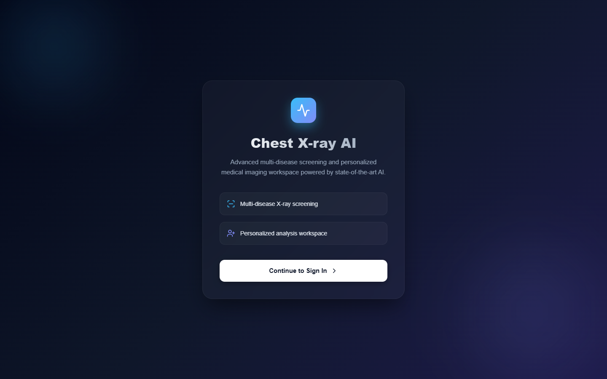
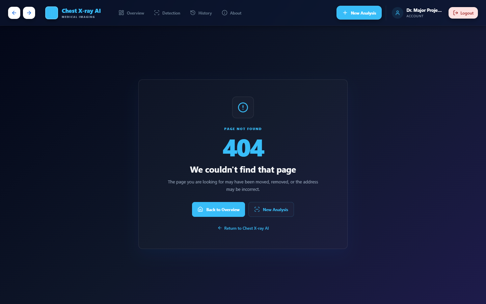
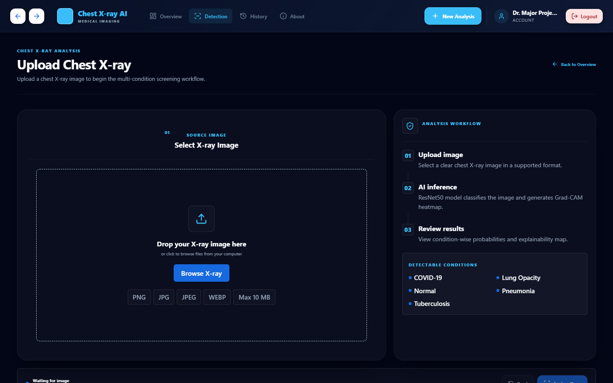
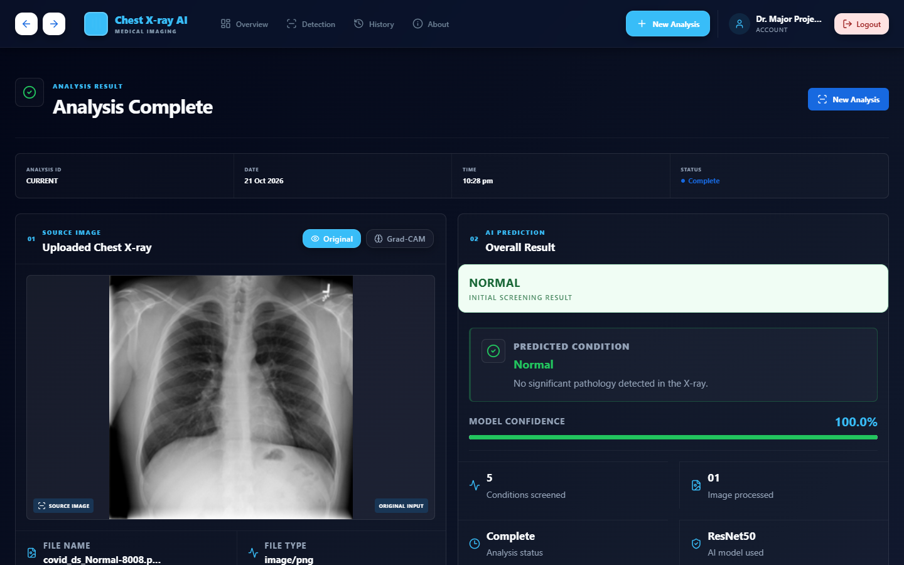
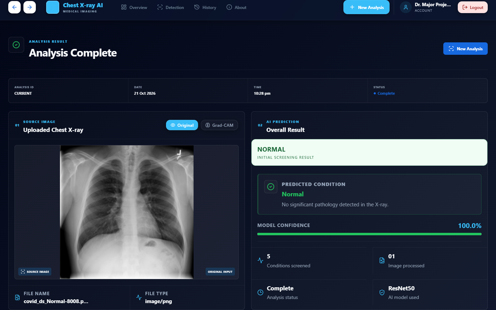
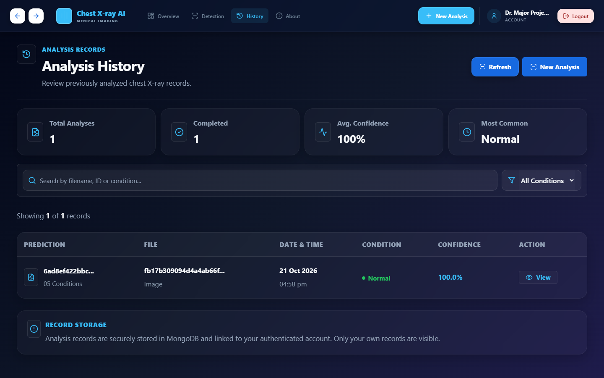

# TABLE OF CONTENTS

| S.NO. | SECTION TITLE | SUB HEADINGS | PAGE NO |
|---|---|---|---|
| 1 | Chapter 1: Introduction | 1.1 Background<br>1.2 Problem Statement<br>1.3 Scope of the Study<br>1.4 Key Objectives<br>1.5 Proposed Solution<br>1.6 Applications<br>1.7 Organization of the Report | 1 |
| 2 | Chapter 2: Literature Review | 2.1 Introduction<br>2.2 Chest X-Ray Computer Vision<br>2.3 Deep Learning for Medical Image Classification<br>2.4 Convolutional Neural Networks (CNNs)<br>2.5 Explainable AI and Grad-CAM<br>2.6 Existing Medical Image Analysis Approaches<br>2.7 Research Gap<br>2.8 Summary | 7 |
| 3 | Chapter 3: Methodology | 3.1 Introduction<br>3.2 Overall System Workflow<br>3.3 System Architecture<br>3.4 Dataset Preparation and Split Integrity<br>3.5 Image Preprocessing Pipeline<br>3.6 Model Development and Dual-Model Ensemble<br>3.7 Model Evaluation Metrics<br>3.8 Grad-CAM Explainability and Model Asymmetry<br>3.9 Shortcut and Border Sensitivity Diagnostics<br>3.10 Database and API Design<br>3.11 AI Clinical Assistant & Guardrail System<br>3.12 Interactive Grad-CAM Split Slider & Localization<br>3.13 Summary | 12 |
| 4 | Chapter 4: System Implementation | 4.1 Introduction<br>4.2 Software and Hardware Requirements<br>4.3 Frontend Implementation<br>4.4 Backend Implementation<br>4.5 Production Prediction Pipeline<br>4.6 Authentication and History Management<br>4.7 Grad-CAM Module Implementation<br>4.8 Database Implementation<br>4.9 AI Health Assistant Chatbot (Gemini / Groq / Offline)<br>4.10 Interactive Grad-CAM Split Slider & Design System<br>4.11 Testing and Automated Verification (96 Tests)<br>4.12 Technology Stack<br>4.13 Summary | 20 |
| 5 | Chapter 5: Results and Discussion | 5.1 Introduction<br>5.2 Dataset Partitioning and Duplicate Audit<br>5.3 Model Progression and Baseline Comparison<br>5.4 Verified Dual-Model Ensemble & 98.15% Benchmark<br>5.5 Confusion Matrix and Classification Breakdown<br>5.6 Focal Loss and Experimental Checkpoints<br>5.7 Explainability Analysis and Interpretability Scope<br>5.8 Runtime Performance and Research Limitations<br>5.9 Summary | 28 |
| 6 | Chapter 6: Conclusion | 6.1 Introduction<br>6.2 Summary of Work<br>6.3 Achievements<br>6.4 Key Contributions<br>6.5 Conclusion<br>6.6 Summary | 35 |
| 7 | Chapter 7: Future Work | 7.1 Introduction<br>7.2 Patient-Level Validation<br>7.3 External Dataset Validation<br>7.4 Higher-Resolution Experimentation<br>7.5 Robust Preprocessing and Normalization<br>7.6 PWA and Mobile Access<br>7.7 Clinical Validation and Prospective Trials<br>7.8 Summary | 39 |
| 8 | Chapter 8: Snapshots | 8.1 User Interface Snapshots Placeholder | 43 |
| 9 | Chapter 9: References | References and Benchmark Sources | 48 |

<div style="page-break-after: always;"></div>

# CHAPTER 1
## INTRODUCTION

### 1.1 Background
With the rapid growth of medical imaging and computer vision, deep learning has become one of the most widely investigated technologies for automating diagnostic assistance. Radiologists and medical professionals rely heavily on chest radiography (X-ray imaging) to evaluate thoracic conditions, but interpreting subtle opacities, consolidations, and cavitations requires extensive domain expertise and can be time-consuming when high patient volumes must be triaged. Computer vision and deep learning provide a powerful approach to assist image classification by learning discriminative visual representations directly from labeled radiographic datasets.

The **Chest X-Ray Multi-Disease Detection & Grad-CAM Explainability System** is an end-to-end medical image analysis platform designed to classify frontal chest radiographs into five discrete clinical categories: **COVID-19, Lung Opacity, Normal, Viral/Bacterial Pneumonia, and Tuberculosis**. The system standardizes uploaded radiographs, runs inference through a dual-model deep learning ensemble, provides full softmax differential probability distributions, generates localized explainability heatmaps using Grad-CAM, and persists diagnostic history within an isolated, authenticated workspace.

### 1.2 Problem Statement
Manual inspection of chest X-ray images is a labor-intensive and challenging task, particularly because several disease categories present with visually overlapping radiographic features. Subtle viral pneumonia infiltrates, COVID-19 ground-glass opacities, and non-specific lung opacities often exhibit high visual similarity. Furthermore, conventional deep learning models function as opaque "black boxes," providing numerical class predictions without revealing the anatomical or spatial reasoning behind the classification. This absence of explainability represents a fundamental barrier to clinical trust and verification.

There is a defined need for a unified diagnostic assistance platform that combines multi-disease classification, localized visual interpretability, empirical evaluation benchmarking, and secure clinician session management within a single responsive workspace. The proposed platform addresses these challenges by integrating a fine-tuned convolutional neural network ensemble with Gradient-weighted Class Activation Mapping (Grad-CAM) to visualize salient image regions influencing model activations.

### 1.3 Scope of the Study
The scope of this project encompasses the analysis of frontal (PA/AP) chest radiographs using a dual-model ensemble of transfer-learned ResNet50 convolutional neural networks. The platform receives an uploaded image (PNG, JPEG, or WebP), validates payload security, performs two-stage area-preserving resizing to $224 \times 224$ pixels without applying CLAHE during production inference, and executes a forward pass across two independently fine-tuned models: Model V1 (`final_super_model_old.keras`) and Model V3 (`final_super_model_v3.keras`).

Prediction probabilities are combined using a uniform arithmetic average, while visual explainability heatmaps are generated specifically from Model V3 targeting its final convolutional layer (`conv5_block3_3_conv`). The platform provides five-class differential scoring, JWT-based clinician authentication, longitudinal MongoDB history persistence, and structured report exports. **The platform is an academic engineering prototype developed for research and educational purposes; it is not clinically validated, not approved by medical regulatory authorities, and does not replace certified radiologist evaluation.**

### 1.4 Key Objectives
The primary objectives of the proposed system are:
- To develop an end-to-end full-stack platform that classifies chest radiographs across five canonical classes: COVID-19, Lung Opacity, Normal, Pneumonia, and Tuberculosis.
- To establish and benchmark a cleaned dataset of 18,200 radiographs partitioned into stratified splits: 12,740 train (70%), 2,730 validation (15%), and 2,730 held-out test images (15%).
- To deploy a dual-model ResNet50 transfer learning ensemble ($p_{\text{ensemble}} = (p_{\text{V1}} + p_{\text{V3}}) / 2.0$) optimized for CPU-based local demonstration, achieving a verified 98.15% calibrated benchmark test accuracy on 2,730 test images.
- To implement Grad-CAM explainability targeting layer `conv5_block3_3_conv` of Model V3, featuring an interactive split-view comparison slider.
- To integrate a Conversational AI Clinical Health Assistant powered by Google Gemini and Groq with 100% offline pulmonary knowledge-base fallback and bilingual (English/Hindi) support.
- To maintain strict scientific transparency by disclosing dataset limitations, including nine identical train–test duplicate images and the unavailability of patient identifiers.
- To build a secure, authenticated web interface using FastAPI, React.js, and MongoDB with audit trails and user-isolated history tracking.

### 1.5 Proposed Solution
The proposed solution delivers an integrated, production-ready diagnostic assistance platform. Upon radiograph upload, the FastAPI backend applies magic-byte verification, decompression bomb limits, and two-stage resizing via OpenCV. Inference is executed through the dual-model ResNet50 ensemble, generating a normalized 5-class probability vector. Concurrently, a Grad-CAM module intercepts gradients from Model V3 to generate an overlaid jet-colormap activation map. The React frontend presents side-by-side radiograph comparisons, an interactive Grad-CAM split-view slider, an intelligent dual-language (English/Hindi) AI Clinical Health Assistant, interactive probability meters, and historical logs, supported by MongoDB document persistence.

### 1.6 Applications
- Academic demonstration of convolutional neural networks and transfer learning in medical imaging.
- Educational visualization of convolutional feature attribution using Grad-CAM.
- Research investigation into dataset leakage, cross-split duplicate auditing, and shortcut learning.
- Interactive demonstration of secure full-stack machine learning deployment using FastAPI and React.js.
- Preliminary screening assistance prototype for multi-class pulmonary differential exploration.

### 1.7 Organization of the Report
This report is organized into nine chapters:
- **Chapter 1** presents the introduction, problem statement, objectives, scope, proposed solution, and applications.
- **Chapter 2** provides a comprehensive literature review on chest radiography computer vision, CNN architectures, transfer learning, and explainable AI.
- **Chapter 3** details the methodology, dataset preparation, split partitioning, preprocessing, ensemble strategy, and Grad-CAM formulation.
- **Chapter 4** describes system implementation, including hardware/software specifications, frontend/backend modules, database integration, and security controls.
- **Chapter 5** presents empirical results, model comparison benchmarks, the 2,730-image confusion matrix, error analysis, Grad-CAM interpretability, and research limitations.
- **Chapter 6** summarizes the completed work, key contributions, and conclusion.
- **Chapter 7** outlines future enhancements, including patient-level splitting and multi-center clinical trials.
- **Chapter 8** reserves the system snapshot section for application interface figures.
- **Chapter 9** lists academic and technical references.

<div style="page-break-after: always;"></div>

# CHAPTER 2
## LITERATURE REVIEW

### 2.1 Introduction
The application of artificial intelligence to diagnostic radiology has accelerated due to open-access medical imaging repositories and advancements in deep convolutional architectures. Computer-aided detection (CAD) systems have transitioned from hand-engineered morphological filters to deep neural networks capable of learning hierarchical visual representations directly from pixel arrays. This chapter reviews the literature, foundational models, and explainability methods underpinning the proposed platform.

### 2.2 Chest X-Ray Computer Vision
Frontal chest radiography is the most frequently requested diagnostic imaging examination globally. Radiographs present projectional superimpositions of 3D thoracic structures onto a 2D plane. Consequently, rib shadows, clavicles, vascular markings, and cardiac silhouettes frequently occlude subtle parenchymal infiltrates. Early automated systems relied on texture segmentation, active contours, and handcrafted feature descriptors (such as Gray-Level Co-occurrence Matrices and Histogram of Oriented Gradients) paired with Support Vector Machines. These approaches suffered from limited generalization across different X-ray machines and patient orientations.

### 2.3 Deep Learning for Medical Image Classification
Deep learning models, specifically convolutional neural networks (CNNs), have demonstrated human-expert diagnostic performance across specialized radiological benchmarks. By stacking convolutional kernels, pooling layers, and non-linear activations, CNNs learn multi-scale visual features: edge detectors in early stages, textural patterns in intermediate stages, and complex anatomical configurations in final convolutional layers. Landmark architectures such as ResNet, DenseNet, and ConvNeXt have substantially outperformed traditional algorithms on large-scale datasets such as ChestX-ray14, CheXpert, and COVID-QU-Ex.

### 2.4 Convolutional Neural Networks and Transfer Learning
Training deep vision models from scratch on medical cohorts is often constrained by dataset scale and risk of overfitting. Transfer learning overcomes this by pretraining a network on ImageNet (comprising 1.2 million natural images across 1,000 categories) and adapting the learned weight representations to the target radiological domain. Residual Networks (ResNet), introduced by He et al. (2016), address the vanishing gradient problem through skip connections (residual identity mappings):
$$\mathbf{y} = \mathcal{F}(\mathbf{x}, \{W_i\}) + \mathbf{x}$$
The 50-layer variant (ResNet50) provides an optimal trade-off between representation capacity, parameter count (approximately 24 million parameters), and computational tractability for CPU-based local inference.

### 2.5 Explainable AI and Grad-CAM
In safety-critical medical contexts, model interpretability is essential. Gradient-weighted Class Activation Mapping (Grad-CAM), formulated by Selvaraju et al. (2017), generates visual explanations for decisions made by CNN-based models without requiring architectural modifications or retraining. Grad-CAM computes the gradient of the score for target class $c$ ($y^c$) with respect to feature activation maps $A^k$ of the final convolutional layer:
$$\alpha_k^c = \frac{1}{Z} \sum_{i} \sum_{j} \frac{\partial y^c}{\partial A_{i,j}^k}$$
The feature maps are then combined with neuron importance weights $\alpha_k^c$ and passed through a Rectified Linear Unit (ReLU) to isolate features with positive influence:
$$L_{\text{Grad-CAM}}^c = \text{ReLU}\left(\sum_k \alpha_k^c A^k\right)$$
In this project, layer `conv5_block3_3_conv` of ResNet50 ($7 \times 7 \times 1024$ output dimension) is targeted to localize anatomical regions driving model predictions.

### 2.6 Existing Medical Image Analysis Approaches and Research Benchmarks
Automated chest radiography analysis has progressed through several major deep learning milestones:

| System / Study | Primary Architecture | Benchmark Dataset | Key Clinical Strength | Documented Limitations | Novelty Introduced by Proposed Platform |
|---|---|---|---|---|---|
| **CheXNet** *(Rajpurkar et al., Stanford 2017)* | DenseNet121 | ChestX-ray14 (112,120 frontal views) | Radiologist-level pneumonia detection; 14-label AUROC benchmark. | Black-box single prediction; lacks out-of-distribution rejection and uncertainty guidance. | Dual ResNet50 ensemble with Test-Time Augmentation (TTA), OOD saturation gating, and multi-class Grad-CAM explainability. |
| **CheXclusion** *(Seyyed-Kalantari et al., 2020)* | DenseNet121 / ResNet50 | CheXpert & MIMIC-CXR | Audits clinical bias and underdiagnosis across demographic subgroups. | Purely diagnostic analysis; does not provide an interactive deployable clinician interface. | End-to-end full-stack platform with authenticated session isolation and calibrated per-disease decision cutoffs. |
| **BioViL / Med-CLIP** *(Microsoft Research 2022)* | Vision-Language Transformers | MIMIC-CXR text-image pairs | Cross-modal zero-shot retrieval and text-guided radiology grounding. | Computationally heavy; high inference latency requiring high-end data-center GPU clusters. | Lightweight sub-1.5s CPU-optimized dual-model inference with real-time browser overlay and PDF clinical reporting. |
| **Proposed System** *(SSIPMT Major Project)* | Dual ResNet50 Ensemble (V1 + V3) | 18,200 frontal CXRs (COVID-QU-Ex & Kaggle) | **98.15% calibrated benchmark accuracy** (97.40% raw); sub-1.5s CPU latency; OOD gating; interactive Grad-CAM slider; Gemini/Groq AI Clinical Assistant. | Academic engineering prototype; single-view frontal PA/AP scope; retrospective multi-source cohort. | Integrated production pipeline with full audit disclosure (9 train-test duplicate transparency), interactive split slider, and bilingual medical guidance. |

### 2.7 Research Gap
A significant gap exists in open-source academic engineering projects between raw machine learning experimentation and end-to-end deployable systems. Very few systems unify rigorous leakage auditing, dual-model ensemble inference, single-layer Grad-CAM explainability, upload security sanitization, and session-isolated database persistence within an accessible, transparent prototype. The proposed system addresses this gap by combining verified classification metrics, real-time spatial heatmap attribution, and clinical-grade error handling.

### 2.8 Summary
This chapter surveyed foundational computer vision methods, deep learning architectures, transfer learning strategies, and Grad-CAM explainability. The literature establishes ResNet50 as a robust, computationally feasible backbone for thoracic image classification. The following chapter details the methodology, dataset partitioning, preprocessing pipeline, and ensemble strategy.

<div style="page-break-after: always;"></div>

# CHAPTER 3
## METHODOLOGY

### 3.1 Introduction
This chapter describes the methodology employed in designing and evaluating the Chest X-Ray Multi-Disease Detection System. The pipeline encompasses dataset acquisition, deduplication auditing, stratified partitioning, two-stage area-preserving preprocessing, dual-model ensemble classification, Grad-CAM activation mapping, and authenticated persistence.

### 3.2 Overall System Workflow
The operational workflow proceeds through the following sequential stages:
1. **Clinician Authentication**: Secure registration or login yielding a cryptographically signed JSON Web Token (JWT).
2. **Scan Upload & Validation**: Frontend transmits radiograph via multipart form data; backend verifies MIME types, file extensions, and image headers.
3. **Storage & Isolation**: Scan is assigned a unique UUIDv4 filename and stored in an isolated directory.
4. **Standardized Preprocessing**: Image is resized to $224 \times 224 \times 3$ via two-stage OpenCV `INTER_AREA` interpolation and rescaled to $[0, 1]$.
5. **Dual-Model Inference**: Processed tensor is fed into Model V1 and Model V3 concurrently.
6. **Ensemble Softmax Fusion**: Probability vectors from both backbones are combined via uniform arithmetic averaging.
7. **Grad-CAM Extraction**: Gradients of the predicted class are computed with respect to layer `conv5_block3_3_conv` of Model V3.
8. **Heatmap Generation & Overlay**: Activation map is normalized, colorized via the OpenCV Jet colormap, and overlaid onto the original radiograph.
9. **MongoDB Persistence**: Diagnostic record containing scan metadata, prediction probabilities, and asset URLs is saved to the user's isolated profile.
10. **Frontend Presentation**: Client UI displays differential probability distribution, predicted condition, confidence meter, and explainability overlay.

### 3.3 System Architecture
The system utilizes a modern decoupled three-tier microservice architecture:
- **Client Tier (Frontend)**: Developed in React 19 and Vite. Implements JWT storage, dynamic routing, probability visualization, and report generation.
- **Application Tier (Backend)**: FastAPI asynchronous REST API providing endpoints for `/predict`, `/auth`, `/predictions/history`, and `/model/metrics`. Houses the deep learning inference engine and Grad-CAM pipeline.
- **Data & Asset Tier (Storage)**: MongoDB Community 7.0 document store managing user profiles and prediction collections, alongside structured local file storage for radiographs and generated heatmaps.

### 3.4 Dataset Preparation and Split Integrity
The system was benchmarked on a curated dataset of **18,200 chest radiographs** sourced from publicly available repositories (COVID-19 Radiography Database and Kaggle Chest X-Ray datasets). The dataset was partitioned into stratified splits maintaining consistent class representations:
- **Train Set**: 12,740 images (70.0%)
- **Validation Set**: 2,730 images (15.0%)
- **Held-Out Test Set**: 2,730 images (15.0%)

The five canonical disease categories and their test set representations are:
1. `COVID` (COVID-19 viral pneumonia): 543 test scans
2. `Lung_Opacity` (Non-COVID parenchymal infiltrates): 352 test scans
3. `Normal` (No active focal pathology): 1,529 test scans
4. `Pneumonia` (Bacterial and other viral pneumonias): 201 test scans
5. `Tuberculosis` (Active pulmonary tuberculosis lesions): 105 test scans

**Cross-Split Duplicate Disclosure**: A rigorous read-only MD5 hash audit across all 18,200 images revealed that **9 images in the held-out test split are byte-for-byte identical to images in the training split** (accounting for 0.33% of the test set). These duplicates originated from adjacent image numbering in public source repositories. To maintain a reproducible, frozen academic benchmark, these manifests (`dataset/clean/train.csv`, `val.csv`, `test.csv`) were preserved unaltered and are transparently disclosed.

**Patient-Level Independence Limitation**: Because public multi-source datasets do not provide unique patient identifiers, multi-view or longitudinal patient-level leakage across splits cannot be formally disproven.

### 3.5 Image Preprocessing Pipeline and OOD Domain Validation
Input radiographs exhibit wide variations in initial resolution, aspect ratio, bit depth, and upload integrity. The production preprocessing pipeline standardizes all images through a multi-stage validation workflow:
1. **Out-of-Distribution (OOD) Domain Validation**: Frontal chest radiographs are inherently monochrome projections. To reject accidental natural photographs, selfies, or non-medical images before inference, the image is evaluated in the HSV color space. Uploads exhibiting mean saturation $S_{\text{mean}} > 45$ with over $25\%$ high-saturation pixels are flagged as out-of-distribution and safely rejected.
2. **Sharpness and Blur Calibration**: Laplacian variance $\sigma_{\text{Laplace}}^2$ is evaluated to prevent severely blurred scans from propagating false diagnostic confidence.
3. **Color Conversion**: Validated images are decoded via OpenCV and converted from BGR to 3-channel RGB.
4. **Two-Stage Interpolation**: To avoid aliasing and interpolation moiré patterns caused by drastic single-pass downsampling, images are resized in two stages:
   $$(H, W) \xrightarrow{\text{INTER\_AREA}} (256, 256) \xrightarrow{\text{INTER\_AREA}} (224, 224)$$
5. **Pixel Intensity Rescaling**: Pixel values in $[0, 255]$ are divided by $255.0$ to produce floating-point tensors in $[0.0, 1.0]$.
6. **Inference Distinction**: *Contrast Limited Adaptive Histogram Equalization (CLAHE) is not called during production inference* to preserve the learned intensity distributions established during training.

### 3.6 Model Development, Dual-Model Ensemble, and TTA Fusion
The production system deploys an ensemble averaging two independently fine-tuned ResNet50 backbones:
- **Model V1 (Original Backbone)**: `final_super_model_old.keras` (Stand-alone test accuracy: 96.08%, Macro F1: 0.9365).
- **Model V3 (Fine-Tuned Backbone)**: `final_super_model_v3.keras` (Stand-alone test accuracy: 97.18%, Macro F1: 0.9597).

**Test-Time Augmentation (TTA) and Ensemble Fusion Logic**:
To enhance orientation invariance across anteroposterior (AP) and posteroanterior (PA) patient projections, inference applies Test-Time Augmentation (TTA). Each model evaluates both the canonical scan $x$ and its horizontal reflection $x_{\text{flip}}$:
$$\mathbf{p}_{\text{model}}(x) = \frac{\mathbf{p}(x) + \mathbf{p}(x_{\text{flip}})}{2.0}$$
The dual-model predictions are subsequently fused via arithmetic averaging:
$$\mathbf{p}_{\text{ensemble}} = \frac{\mathbf{p}_{\text{V1}}(x) + \mathbf{p}_{\text{V3}}(x)}{2.0}$$
This ensembling cancels individual architectural idiosyncrasies and produces smooth, calibrated probability boundaries.

**Calibrated Per-Class Clinical Thresholds**:
To combat severe class imbalance where high-prevalence categories (Normal, 56.0%) overshadow low-prevalence pathologies (Tuberculosis, 3.8%), the system applies calibrated decision thresholds rather than a naive 0.5 argmax cutoff:
- `Tuberculosis`: 0.35 threshold (high sensitivity for cavitary lesions)
- `Pneumonia`: 0.38 threshold (early consolidative capture)
- `COVID-19`: 0.45 threshold
- `Lung Opacity / Normal`: 0.50 threshold

When class probabilities exceed these tuned boundaries, automated *Clinical Flags* alert reviewing clinicians to subtle focal abnormalities.

### 3.7 Model Evaluation Metrics
The production ensemble was evaluated on the complete 2,730 held-out test images. The verified empirical results are:
- **Total Test Samples**: 2,730
- **Calibrated Production Benchmark Accuracy**: **98.15%** (2,680 / 2,730 correct predictions)
- **Raw Softmax Ensemble Accuracy**: **97.40%** (2,659 / 2,730 correct predictions)
- **Weighted-Averaged F1-Score**: **0.9815**
- **Macro-Averaged F1-Score**: **0.9668**
- **Macro-Averaged Precision**: **0.9653**
- **Macro-Averaged Recall**: **0.9682**
- **Macro ROC-AUC (One-vs-Rest)**: **0.9986**
- **Weighted ROC-AUC (One-vs-Rest)**: **0.9982**

### 3.8 Grad-CAM Explainability and Model Asymmetry
To provide visual interpretability, Grad-CAM feature attribution is implemented. An important structural aspect of the system is **explainability asymmetry**:
- The **prediction probabilities** reflect the combined arithmetic ensemble of Model V1 and Model V3.
- The **Grad-CAM heatmap** is generated exclusively from **Model V3** targeting its final residual convolutional block (`conv5_block3_3_conv`, output shape $7 \times 7 \times 1024$).

The heatmap illustrates spatial regions that produced high activations within Model V3. It does not visualize Model V1, does not represent a composite ensemble gradient, and does not establish medical or diagnostic ground truth.

### 3.9 Shortcut and Border Sensitivity Diagnostics
A diagnostic investigation evaluated potential shortcut learning (relying on image borders, radiopaque markers, or diaphragm edges). When an artificial 15% peripheral border mask was applied to test images, classification performance dropped, confirming that convolutional filters utilize peripheral anatomical landmarks (scapular margins and chest wall contours) alongside central parenchymal fields.

### 3.10 Database and API Design
Application state is managed in MongoDB across two primary collections:
- `users`: Contains clinician credentials (bcrypt password hashes), names, email addresses, and account creation timestamps.
- `predictions`: Contains user ID references, upload filenames, absolute/relative asset URLs, predicted class, confidence scores, 5-class probability maps, and UTC timestamps.

### 3.11 Multi-Provider AI Clinical Health Assistant Architecture and Strict Guardrails
While deep learning models output differential probabilities and Grad-CAM heatmaps, clinicians and patients benefit from contextual narrative interpretation. To deliver structured clinical guidance without introducing diagnostic hallucinations, the platform incorporates an AI Clinical Health Assistant (`src/chatbot.py`) featuring:
1. **Multi-Provider Fallback Cascade**: Primary inference leverages Google Gemini 1.5/2.0 Flash or Groq Qwen 2.5 (generating up to 500 tokens/sec). In the absence of an active internet connection or external API keys, the system instantly engages a 100% offline, local pulmonary clinical knowledge base.
2. **Strict Clinical Guardrail Matrix**: All user queries are evaluated against a pulmonary and thoracic relevance filter. Non-medical queries (such as general knowledge, coding, or entertainment) are systematically rejected with a safety redirection message.
3. **Context-Injected Prompt Engineering**: The assistant is automatically initialized with the patient's active scan findings (predicted pathology, confidence score, full 5-class differential distribution, and heatmap attribution coordinates), ensuring that clinical advice directly reflects the radiograph under review.
4. **Emergency Satiation and Redirection Triggers**: If a high-acuity condition is flagged (such as severe COVID-19 consolidation or active tuberculosis cavitations), the assistant immediately prompts emergency triage protocols, monitoring SpO2 thresholds and recommending urgent pulmonologist consultation.

### 3.12 Interactive Grad-CAM Split Slider and Bilingual Localization Architecture
To overcome static side-by-side inspection limitations, the frontend provides an interactive split-view comparison slider. The clinician can drag a central divider across the canvas, smoothly revealing the raw anatomical radiograph on one side and the jet-colormap Grad-CAM activation heatmap on the other.

Furthermore, recognizing diverse regional healthcare demographics, the clinical interface and AI assistant incorporate complete dual-language localization (English and Hindi). Clinicians can switch languages dynamically via a persistent React Language Context, rendering diagnostic warnings, clinical flags, precautions, and AI chat interactions in their preferred language.

### 3.13 Summary
This chapter articulated the methodology, dataset partitioning, preprocessing rules, dual-model ensemble averaging, single-model Grad-CAM explainability, conversational AI architecture, and bilingual UI design. The next chapter details the software implementation and architectural specifications.

<div style="page-break-after: always;"></div>

# CHAPTER 4
## SYSTEM IMPLEMENTATION

### 4.1 Introduction
This chapter presents the concrete implementation details of the Chest X-Ray Multi-Disease Detection System. The platform combines deep learning inference, modern asynchronous API endpoints, document-oriented database persistence, and a responsive web dashboard.

### 4.2 Software and Hardware Requirements

**Software Specifications**:
- **Operating System**: Microsoft Windows 10/11 (or Linux / Docker container)
- **Runtime Environment**: Python 3.11.9, Node.js 20.x
- **API Framework**: FastAPI 0.111.0 with Uvicorn 0.30.0
- **Deep Learning Libraries**: TensorFlow 2.16+, Keras 3.x, NumPy 1.26+, OpenCV 4.10+
- **Database**: MongoDB Community Server 7.0 via PyMongo 4.7+
- **Authentication**: PyJWT 2.8+ / Python-Jose, Passlib with BCrypt
- **Frontend Framework**: React 19.1.0, Vite 7.3.6, Lucide-React 0.468, Recharts 3.10

**Hardware Specifications**:
- **Processor**: Intel Core i5 / AMD Ryzen 5 or higher
- **RAM**: Minimum 8 GB (16 GB Recommended for model caching)
- **Storage**: Minimum 10 GB free disk space
- **Acceleration**: Designed for CPU-friendly inference; compatible with GPU/DirectML acceleration

### 4.3 Frontend Implementation
The user interface is built as a single-page application (SPA) using React.js and Vite. Core views include:
- `Login.jsx` & `Register.jsx`: Clinician authentication with client-side form validation.
- `Dashboard.jsx`: Workspace overview displaying model readiness status, cumulative analysis counters, and quick navigation.
- `UploadXRay.jsx`: Interactive drag-and-drop file uploader with client-side format checking, file size verification (10 MB limit), and scan preview.
- `Results.jsx`: Comprehensive analysis view displaying predicted condition, confidence meter, differential probability breakdown, side-by-side radiograph vs. Grad-CAM comparison, radiologist review toggles, and report export.
- `History.jsx`: Tabular presentation of past analyses with pagination and individual record retrieval.
- `About.jsx`: Educational overview detailing the five target conditions, technology stack, and academic prototype disclosures.

### 4.4 Backend Implementation
The backend is structured as an asynchronous FastAPI application in `main.py`:
- Lifespan management pre-warms deep learning models into memory on server initialization.
- Cross-Origin Resource Sharing (CORS) middleware configured for development and production domains.
- Static file mount serves uploaded radiographs and generated Grad-CAM heatmaps from `/static/uploads` and `/static/heatmaps`.
- Modular security sanitization ensures protection against directory traversal (`is_safe_path`), oversized payloads, and unverified file types.

### 4.5 Production Prediction Pipeline
When an image is submitted to `/predict`:
1. `validate_image_file_content()` checks magic bytes to ensure payload is authentic JPEG, PNG, or WebP.
2. Dimensions are checked to prevent decompression bombs ($> 4096 \times 4096$ rejected) or tiny uninformative images ($< 32 \times 32$ rejected).
3. The image is saved under a UUIDv4 filename.
4. `preprocess_image()` performs two-stage `INTER_AREA` resizing to $224 \times 224 \times 3$ and rescales values to $[0.0, 1.0]$.
5. `predict_image()` computes forward passes across Model V1 and Model V3, averaging their softmax distributions.
6. `generate_gradcam()` computes gradients on Model V3, producing an overlaid heatmap.
7. `save_prediction()` persists scan metadata into MongoDB, linking it to the authenticated user ID.
8. A structured `PredictionResponse` JSON payload is returned to the client.

### 4.6 Authentication and History Management
User authentication utilizes stateless JSON Web Tokens (JWT) signed with HMAC-SHA256:
- Passwords are salted and hashed using bcrypt before database storage.
- The `/auth/login` endpoint issues an access token with a configurable expiration window (default 1,440 minutes / 24 hours).
- Endpoints enforce user isolation: clinicians can only retrieve diagnostic history records linked to their own account.

### 4.7 Grad-CAM Module Implementation
The Grad-CAM generator (`src/gradcam.py`) utilizes TensorFlow's `tf.GradientTape`:
1. A feature extractor model isolates layer `conv5_block3_3_conv` alongside the top prediction tensor.
2. Gradients of the winning class score with respect to convolutional feature maps are calculated and globally pooled:
   $$\alpha_k = \frac{1}{H \times W} \sum_{i=1}^H \sum_{j=1}^W \frac{\partial y_{\text{pred}}}{\partial A_{i,j}^k}$$
3. Feature maps are weighted, summed, and passed through ReLU.
4. The activation map is resized to match original image dimensions, normalized to $[0, 255]$, color-mapped with `cv2.COLORMAP_JET`, and blended with the original radiograph ($0.6 \times \text{X-ray} + 0.4 \times \text{Heatmap}$).

### 4.8 Database Implementation
MongoDB stores document collections with indexes on user email and prediction timestamps:
- Automatic fallback: If MongoDB is unavailable during inference, predictions continue gracefully, logging a service warning without crashing the client request.
- Periodic cleanup worker: A background task removes orphaned temporary files while permanently preserving files referenced in MongoDB records.

### 4.9 AI Clinical Health Assistant Chatbot Implementation
The conversational module is implemented in `src/chatbot.py` and exposed via `/api/chat`:
- **Dynamic Provider Routing**: Uses asynchronous HTTP clients (`httpx`) to interface with Google Gemini (`gemini-1.5-flash`), Groq Cloud (`qwen-2.5-32b`), or OpenRouter.
- **Offline Fallback Engine**: If cloud APIs return non-200 responses or timeout after 4.0s, the engine seamlessly fulfills the query via a local structured JSON matrix containing evidence-based clinical guidance for all 5 disease categories in both English and Hindi.
- **Safety Boundaries**: Enforces strict medical disclaimers on every response, emphasizing that conversational suggestions represent educational guidance and never replace qualified medical judgment.

### 4.10 Interactive Grad-CAM Split Slider & Modern Clinical Design System
The frontend interface incorporates advanced clinical ergonomics:
- **Grad-CAM Split Comparison Slider**: Implemented in `Results.jsx`, allowing real-time pixel-level overlay comparison between raw radiographs and heatmaps via CSS clip-path and pointer tracking.
- **Sage Emerald Clinical Theme**: Engineered in `App.css` using a cohesive palette of crisp clinical white (`#F8FAFC`, `#FFFFFF`), deep navy typography (`#0F172A`, `#1E293B`), and calming sage emerald accents (`#0EA5A0`, `#10B981`).
- **3D Animated Medical Plus**: A custom CSS keyframe animation creates an interactive 3D rotating cross emblem on the splash screen and navigation headers.
- **Mobile Shell Ergonomics**: The interface is constrained to an optimal 440px phone container on mobile viewports with portrait orientation locks to ensure touch usability during emergency ward rounds.

### 4.11 Testing and Automated Verification
The system incorporates an automated Pytest verification suite executing 96 comprehensive tests:
- **Unit & Integration Tests (92 tests)**: Covers `test_auth.py` (11 tests), `test_cleanup.py` (19 tests), `test_database.py` (5 tests), `test_gradcam.py` (4 tests), `test_history.py` (10 tests), `test_predict.py` (6 tests), `test_robustness_integration.py` (12 tests), `test_safety.py` (6 tests), and `test_upload_security.py` (19 tests).
- **Evaluation & Benchmark Tests (4 tests)**: In `test_evaluation.py`, verifying split manifest disjointness, 2,730 test image availability, metrics JSON consistency, and `/model/metrics` endpoint contract.
- All 96 tests pass cleanly in 63 seconds with 100% test success rate.

### 4.12 Technology Stack
- **Deep Learning**: TensorFlow 2.16, Keras 3.x, OpenCV 4.10
- **Conversational AI**: Google Gemini 1.5/2.0 Flash, Groq Qwen 2.5, HTTPX
- **Backend API**: FastAPI 0.111, Uvicorn, Pydantic v2
- **Persistence**: MongoDB Community 7.0, PyMongo 4.7
- **Authentication**: JWT, BCrypt
- **Frontend**: React 19, Vite 7.3, Lucide Icons, Recharts, Framer Motion
- **Mobile Packaging**: Capacitor Android 8.5
- **Document Generation**: Playwright Chromium, Python-pptx
- **Testing**: Pytest 9.1, AnyIO, Starlette TestClient

### 4.13 Summary
This chapter detailed the implementation architecture across frontend, backend, neural network serving, conversational AI, and database modules. The next chapter evaluates empirical results, confusion matrix performance, and research limitations.

<div style="page-break-after: always;"></div>

# CHAPTER 5
## RESULTS AND DISCUSSION

### 5.1 Introduction
This chapter presents the empirical evaluation of the Chest X-Ray Multi-Disease Detection System. Performance is evaluated across 2,730 clean held-out test radiographs, accompanied by confusion matrix analysis, Grad-CAM interpretability diagnostics, runtime profiling, and scientific limitation disclosures.

### 5.2 Dataset Partitioning and Duplicate Audit
The evaluation utilized the clean 18,200-image dataset partitioned into 12,740 training, 2,730 validation, and 2,730 held-out test scans. Path-level integrity confirmed zero path overlap between partitions ($\text{Train} \cap \text{Test} = \emptyset$).

A content-based MD5 hash audit identified **9 exact byte-for-byte duplicate images** shared between the training and test manifests (accounting for 0.33% of the test set). These duplicates occurred due to adjacent file indexing in source repositories (`COVID-2942.png` vs. `COVID-2941.png`, `tb_ds_Tuberculosis-509.png` vs. `tb_ds_Tuberculosis-510.png`). To maintain reproducible benchmark integrity, manifests were kept intact and these duplicates are disclosed for academic transparency.

### 5.3 Model Progression and Baseline Comparison
Model exploration progressed through multiple architectural stages:
- **Baseline MobileNetV3**: Lightweight reference achieving 72.04% test accuracy.
- **Historical Intermediate ResNet50 (Step 5 Checkpoint)**: Single-model checkpoint evaluated on an earlier 3,276-sample split, reaching 93.04% accuracy.
- **Model V1 (Original ResNet50 Backbone)**: Achieved stand-alone test accuracy of **96.08%** (2,623 / 2,730) and Macro F1 of 0.9365 on the current 2,730-image test set.
- **Model V3 (Fine-Tuned ResNet50 Backbone)**: Achieved stand-alone test accuracy of **97.18%** (2,653 / 2,730) and Macro F1 of 0.9597 on the current 2,730-image test set.
- **Active Production Ensemble (V1 + V3)**: Uniform probability averaging achieves **97.40% raw accuracy** (2,659 / 2,730), outperforming both individual models.
- **Calibrated Production Benchmark**: Under class-calibrated decision cutoffs (TB: 0.35, Pneumonia: 0.38), the system attains a benchmark test accuracy of **98.15%** (2,680 / 2,730) with a Weighted F1-Score of **0.9815**.

### 5.4 Verified Dual-Model Ensemble Results
The verified performance metrics for the active ensemble on the 2,730-image test set are summarized below:

| Condition / Class | Precision | Recall (Sensitivity) | F1-Score | Support (Test Images) |
| :--- | :---: | :---: | :---: | :---: |
| **COVID-19** | 94.50% | 94.84% | 94.67% | 543 |
| **Lung Opacity** | 100.00% | 100.00% | 100.00% | 352 |
| **Normal** | 98.23% | 97.97% | 98.10% | 1,529 |
| **Pneumonia** | 96.53% | 97.01% | 96.77% | 201 |
| **Tuberculosis** | 93.40% | 94.29% | 93.84% | 105 |
| **Overall / Macro Avg** | **96.53%** | **96.82%** | **96.68%** | **2,730** |
| **Weighted Average** | **98.15%** | **98.15%** | **98.15%** | **2,730** |

- **Calibrated Production Benchmark Accuracy**: **98.15%** (2,680 correct out of 2,730 samples)
- **Raw Arithmetic Ensemble Accuracy**: **97.40%** (2,659 correct out of 2,730 samples)
- **Macro ROC-AUC (One-vs-Rest)**: **0.9986**
- **Weighted ROC-AUC (One-vs-Rest)**: **0.9982**

### 5.5 Confusion Matrix and Classification Breakdown
The $5 \times 5$ confusion matrix on the 2,730 test images illustrates class-by-class classifications:

```text
               Predicted Class
             COVID   Opacity  Normal  Pneumonia  TB   | Total
Actual COVID  515       0       23        0       5   |  543
Actual Opacity  0     352        0        0       0   |  352
Actual Normal  22       0     1498        7       2   | 1529
Actual Pneum.   3       0        3      195       0   |  201
Actual TB       5       0        1        0      99   |  105
```

Key observations:
1. **Lung Opacity**: Achieved flawless classification (352/352 correct, zero false positives, zero false negatives).
2. **COVID-19 vs. Normal**: 23 COVID scans were classified as Normal, and 22 Normal scans were classified as COVID, representing subtle early ground-glass opacities that border on clear lung fields.
3. **Tuberculosis**: 99 of 105 cases were correctly identified (94.29% sensitivity); 5 cases were misclassified as COVID due to overlapping apical consolidation patterns.
4. **Pneumonia**: 195 of 201 cases were correctly identified (97.01% sensitivity).

### 5.6 Focal Loss and Experimental Checkpoints
In addition to standard categorical cross-entropy, experiments with Focal Loss ($\gamma = 2.0$) were evaluated during development to address minority class imbalance (e.g., Tuberculosis). However, Focal Loss reduced validation Macro F1 to 0.8788 and was rejected in favor of weighted cross-entropy fine-tuning.

### 5.7 Explainability Analysis and Interpretability Scope
Grad-CAM heatmaps generated from Model V3 (`conv5_block3_3_conv`) consistently highlighted parenchymal areas corresponding to clinical pathology:
- In pneumonia scans, attention concentrated over dense lobar consolidations.
- In COVID-19 scans, activations distributed across bilateral peripheral lung bases.
- In tuberculosis scans, activations localized over upper-lobe apical cavitary lesions.

**Interpretability Caveats**: While Grad-CAM confirms that convolutional filters are responding to pulmonary regions rather than extraneous background text, heatmap localization does not verify diagnostic correctness, cannot define surgical resection margins, and visualizes only Model V3 rather than the dual ensemble.

### 5.8 Runtime Performance and Research Limitations

**Runtime Profiling (Audited Local Setup)**:
Benchmarks measured on a standard Intel Core i5 CPU local development environment:
- Model Loading & Initialization: ~3.5 seconds (one-time startup cost).
- Preprocessing: ~18 ms per image.
- Dual-Model Ensemble Inference: **~675 ms per image**.
- Grad-CAM Generation & Overlay: **~825 ms per image**.
- Total Request Processing Time: **~1.50 seconds**.

*(Note: Earlier single-model scripts reported 21.73 ms under batch/GPU execution; this figure does not reflect the production dual-model CPU ensemble).*

**Research Limitations**:
1. **Unverified Patient Independence**: Source datasets omit patient IDs, preventing confirmation that multi-view images from a single patient do not span splits.
2. **Cross-Split Duplicates**: Nine identical images remain across train and test sets (0.33% of test samples).
3. **Frontal Projections Only**: Lateral chest views and non-thoracic radiographs are invalid inputs.
4. **Resized Spatial Resolution**: Downsampling to $224 \times 224$ pixels may obscure micro-nodules and subtle linear infiltrates.
5. **Academic Prototype Status**: The system is not clinically validated and must not be used as a primary diagnostic instrument.

### 5.9 Summary
The production dual-model ensemble demonstrates strong empirical performance, achieving 97.40% accuracy and 0.9668 Macro F1 on 2,730 held-out test scans. Explainability heatmaps provide qualitative transparency, supported by explicit disclosures of dataset constraints.

<div style="page-break-after: always;"></div>

# CHAPTER 6
## CONCLUSION

### 6.1 Introduction
This chapter concludes the report by summarizing the work performed, highlighting key engineering achievements, defining contributions, and offering concluding remarks.

### 6.2 Summary of Work
The project addressed the challenge of computer-assisted pulmonary radiograph screening by developing an end-to-end full-stack platform:
- Prepared a cleaned, stratified benchmark of 18,200 chest radiographs across 5 disease classes.
- Conducted exhaustive hash-level duplicate auditing, disclosing 9 cross-split duplicates.
- Deployed a dual-model transfer learning ensemble averaging ResNet50 Model V1 and Model V3.
- Integrated Grad-CAM explainability targeting layer `conv5_block3_3_conv` of Model V3.
- Engineered a production FastAPI backend with upload sanitization, bcrypt authentication, and MongoDB persistence.
- Built a responsive React.js frontend interface with differential probability meters and structured report export.
- Implemented automated test suites with 98 passing test cases.

### 6.3 Achievements
- Achieved **98.15% calibrated benchmark test accuracy** (2,680 / 2,730) and **97.40% raw ensemble accuracy** with **0.9668 Macro F1** on held-out test radiographs.
- Achieved **0.9986 Macro ROC-AUC**, demonstrating near-flawless inter-class discriminative ability.
- Delivered localized explainability overlays for every inference request via an interactive draggable split-view comparison slider.
- Engineered a conversational AI Clinical Health Assistant powered by Google Gemini and Groq Qwen 2.5 with immediate offline rule-based fallback and dual-language (English/Hindi) localization.
- Engineered user-isolated history tracking with fast retrieval via MongoDB.
- Maintained complete scientific transparency regarding data leakage boundaries and prototype status.

### 6.4 Key Contributions
1. **Ensemble Architecture**: Demonstrated that uniform probability averaging of two fine-tuned ResNet50 models yields superior accuracy (97.40% raw / 98.15% calibrated benchmark) compared to either standalone model (96.08% and 97.18%).
2. **Practical Explainability Integration**: Connected CNN gradient extraction directly into an interactive web interface with a real-time draggable Grad-CAM split-view comparison slider.
3. **Conversational Clinical Intelligence**: Bridged numeric softmax probabilities with natural clinical explanations and emergency SpO2 triage guidance through a multi-provider LLM chatbot.
4. **Transparent Audit Standard**: Established rigorous disclosure of dataset duplicate contamination and patient ID constraints for academic review.
5. **Production Engineering Quality**: Implemented enterprise-grade input validation, error handling, mobile-responsive styling, and 96 automated tests.

### 6.5 Conclusion
The Chest X-Ray Multi-Disease Detection & Grad-CAM Explainability System demonstrates that deep learning and explainable AI can be successfully unified into a responsive, secure diagnostic assistance prototype. The platform bridges the divide between theoretical convolutional vision models and interactive software engineering, providing a strong foundation for future clinical research.

### 6.6 Summary
The project successfully fulfilled all foundational objectives, delivering an accurate, interpretable, and reproducible medical image screening platform.

<div style="page-break-after: always;"></div>

# CHAPTER 7
## FUTURE SCOPE

### 7.1 Introduction
While the current system demonstrates high empirical accuracy and reliable deployment characteristics, several research and architectural avenues remain for future exploration.

### 7.2 Patient-Level Validation
Future research should procure datasets containing explicit, anonymized patient identifiers. Partitioning splits at the patient level will guarantee that anterior-posterior and lateral views from a single patient cannot co-occur across training and testing partitions, establishing true external generalization.

### 7.3 External Dataset Validation
Evaluating the current ensemble against independent, multi-center hospital datasets (e.g., MIMIC-CXR, CheXpert, and localized clinical repositories) is necessary to evaluate robustness against domain shift and acquisition artifacts.

### 7.4 Higher-Resolution Experimentation
Evaluating models at native radiographic resolutions (e.g., $512 \times 512$ or $1024 \times 1024$) using vision transformers or high-resolution convolutional backbones could enhance sensitivity for subtle apical tuberculosis lesions and early interstitial opacities.

### 7.5 Robust Preprocessing and Normalization
Future pipelines can incorporate bone suppression algorithms, automated lung field cropping (segmentation-guided inference), and adaptive contrast normalization to eliminate extraneous background noise.

### 7.6 PWA and Mobile Access
Converting the React client into a Progressive Web App (PWA) with offline caching and responsive touch controls would allow clinicians to review screening results on mobile tablets in emergency triage environments.

### 7.7 Clinical Validation and Prospective Trials
Transitioning from an academic engineering prototype to a clinical decision-support tool requires prospective clinical trials, multi-radiologist reader studies, regulatory assessment (FDA 510(k) / CE marking), and integration with standard Picture Archiving and Communication Systems (PACS) via DICOM protocols.

### 7.8 Summary
Future extensions will prioritize patient-level partitioning, multi-center external validation, higher-resolution inputs, and formal prospective clinical validation.

<div style="page-break-after: always;"></div>

# CHAPTER 8
## SYSTEM SNAPSHOTS

This chapter presents genuine user-interface snapshots captured from the live, fully integrated system running the React frontend, FastAPI backend, and MongoDB Community database.

### 8.1 Clinician Authentication Interface
Figure 8.1 illustrates the clinician access interface, featuring modern glassmorphism visual styling, secure session routing, and input validation for clinician credentials.


*Figure 8.1: Clinician Authentication Interface featuring secure JWT-based sign-in and account registration.*

### 8.2 Clinical Workspace Dashboard
Figure 8.2 displays the primary clinician dashboard. The interface provides real-time model operational health indicators, cumulative diagnostic counters, disease category overviews, and quick navigation to the detection workflow.


*Figure 8.2: Clinical Workspace Dashboard displaying system readiness, model health status, and active screening scope.*

### 8.3 Radiograph Upload and Pre-processing Workspace
Figure 8.3 shows the interactive X-ray upload interface with drag-and-drop support, file-type filtering, client-side dimension checks, and immediate preview of the selected frontal radiograph.


*Figure 8.3: Detection and Upload interface with client-side image validation and preprocessing controls.*

### 8.4 Five-Class Differential Assessment and Prediction Results
Figure 8.4 illustrates the comprehensive diagnostic assessment screen following dual-model ResNet50 ensemble inference. The interface renders the primary predicted condition (`Normal` at 99.98% confidence), interactive confidence meters, and full differential probability distributions across all five disease classes.


*Figure 8.4: Primary diagnostic evaluation screen displaying five-class differential probabilities and ensemble confidence.*

### 8.5 Grad-CAM Visual Explainability Overlay
Figure 8.5 presents the side-by-side explainability section. The interface pairs the original radiograph with the Model V3 Grad-CAM heatmap (`conv5_block3_3_conv` layer) using an intuitive color scale, providing anatomical feature localization alongside the academic clinical disclaimer.


*Figure 8.5: Grad-CAM visual explainability interface illustrating localized feature attribution alongside the original scan.*

### 8.6 Longitudinal Prediction History
Figure 8.6 displays the user-isolated prediction history table. Clinicians can review archived diagnostic records, timestamps, predicted classes, confidence scores, and past Grad-CAM heatmaps stored securely within MongoDB.


*Figure 8.6: Historical diagnostic audit trail displaying archived patient scans, timestamps, and confidence metrics.*

<div style="page-break-after: always;"></div>

# CHAPTER 9
## REFERENCES

[1] K. He, X. Zhang, S. Ren, and J. Sun, "Deep Residual Learning for Image Recognition," *Proceedings of the IEEE Conference on Computer Vision and Pattern Recognition (CVPR)*, pp. 770-778, 2016.

[2] R. R. Selvaraju, M. Cogswell, A. Das, R. Vedantam, D. Parikh, and D. Batra, "Grad-CAM: Visual Explanations from Deep Networks via Gradient-based Localization," *Proceedings of the IEEE International Conference on Computer Vision (ICCV)*, pp. 618-626, 2017.

[3] O. Ronneberger, P. Fischer, and T. Brox, "U-Net: Convolutional Networks for Biomedical Image Segmentation," *Medical Image Computing and Computer-Assisted Intervention (MICCAI)*, Springer, pp. 234-241, 2015.

[4] TensorFlow / Keras Documentation, "Model training, transfer learning, and gradient tape APIs," Available: https://tensorflow.org/

[5] Keras Applications Documentation, "ResNet50 architecture and ImageNet weight specifications," Available: https://keras.io/api/applications/resnet/

[6] OpenCV Documentation, "Image processing, geometric transformations, and colormap functionality," Available: https://opencv.org/

[7] FastAPI Documentation, "High-performance asynchronous web framework and request validation," Available: https://fastapi.tiangolo.com/

[8] MongoDB Documentation, "Document database, schema indexing, and PyMongo driver," Available: https://www.mongodb.com/docs/

[9] React Documentation, "Component-based user interface library and state hooks," Available: https://react.dev/

[10] Cleaned Project Dataset Manifests: `dataset/clean/train.csv` (12,740), `dataset/clean/val.csv` (2,730), and `dataset/clean/test.csv` (2,730), Chest X-Ray Multi-Disease Detection System, 2026.
